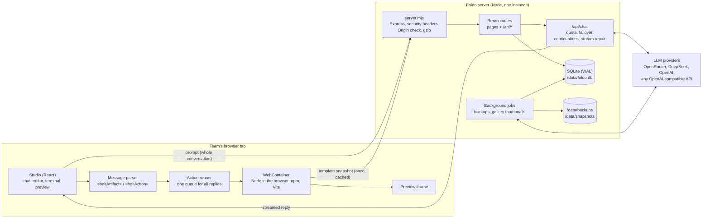
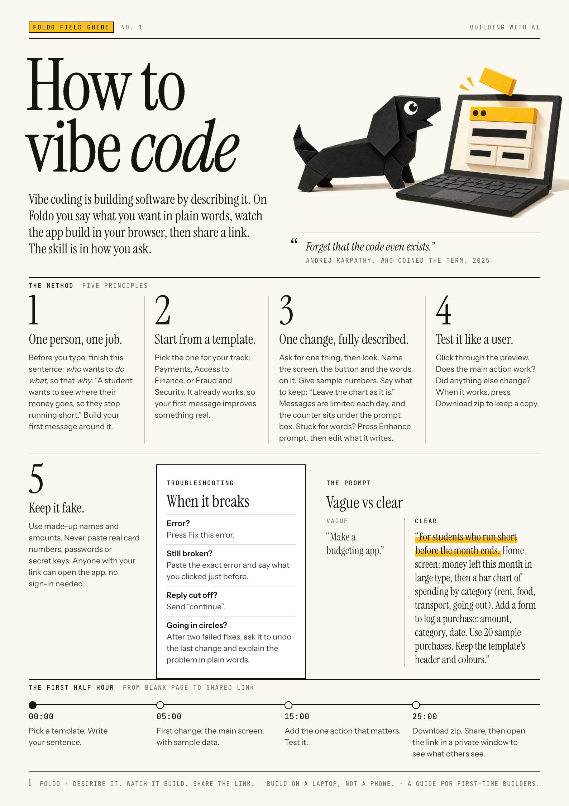
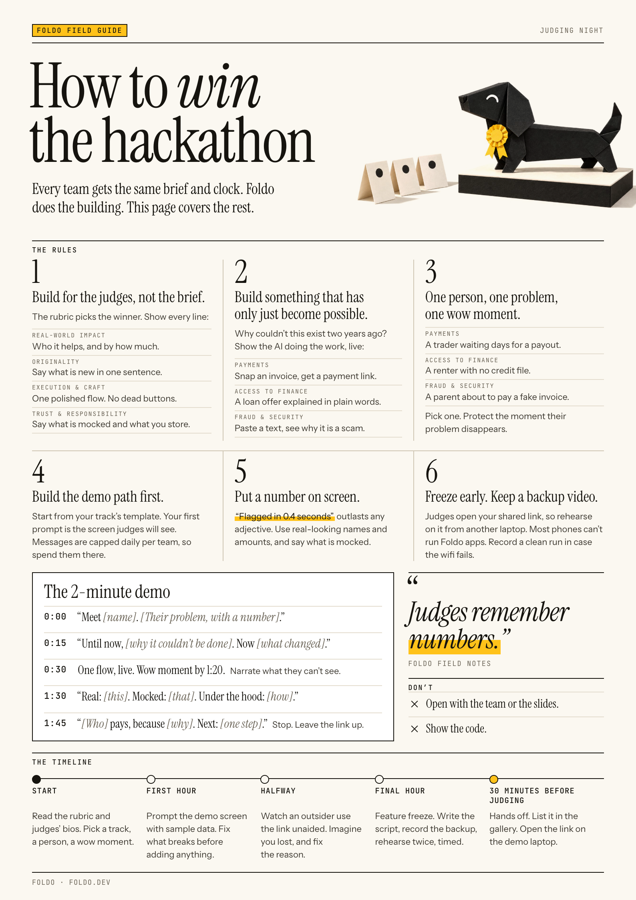

<p align="center">
  
</p>

# Foldo

Foldo is a vibe-coding platform for hackathons. A team describes an app in plain words, an LLM writes it, and the app
installs and runs live in the team's own browser tab ([WebContainers](https://webcontainers.io)). Around that core it
adds accounts, autosaved projects, finance starter templates, public share links, a gallery with likes and AI-drawn
thumbnails, and an organizer console for running the event night (models, quotas, an emergency pause, backups).
It is a Node port of [bolt.new](https://github.com/stackblitz/bolt.new) (MIT) on Remix + Vite and React 18, with SQLite
as its only datastore.

Live: <https://web-production-2fb3c.up.railway.app>

**Contents:** [Quick start](#quick-start) ·
[How it works](#how-it-works) · [Configuration](#configuration) · [Running a hackathon](#running-a-hackathon) ·
[Deploy to Railway](#deploy-to-railway) · [Testing](#testing) · [Design system](#design-system) ·
[Field guides](#field-guides) · [Project structure](#project-structure) · [Troubleshooting and FAQ](#troubleshooting-and-faq) ·
[Licence and credits](#licence-and-credits)

---

## Quick start

Requires Node 22.13 or newer (the server uses the built-in `node:sqlite`).

```sh
cp .env.example .env      # add at least one model key (or add keys later in /admin)
npm install               # .npmrc sets legacy-peer-deps
npm run dev               # Vite dev server on http://localhost:5173
```

Production mode, as on Railway:

```sh
npm run build && npm start    # serves on $PORT (default 3000)
```

`npm run dev`, `npm run build` and `npm start` load `.env` automatically. `dev` and `build` first bundle the templates
(`npm run templates`). The database is created at `./data/foldo.db` unless `DB_PATH` is set.

To become an organizer, put your email in `ADMIN_EMAILS`, sign up with it and open `/admin`. To try things without a
model key, run the stub LLM (see [Testing](#testing)).

---

## How it works

### Architecture



The server never runs generated code. It authenticates, meters, relays the model's streamed reply and stores the
conversation. Everything the model writes (files and shell commands) runs inside the WebContainer in the browser tab
that asked for it, or in the tab of whoever opens a share link.

### A build, end to end

1. **Prompt.** The team types in the studio. `Chat.client.tsx` (the AI SDK's `useChat`) sends the whole conversation
   to `POST /api/chat`, with the chosen model and, for template projects, the template id. The UI-only intro message
   (`tpl-intro`) is dropped before the model sees it.
2. **Gatekeeping (`routes/api.chat.ts`).** In order: signed in, not paused, a valid conversation (at most 120 messages,
   last one from the user), history compacted (older copies of rewritten files become one-line notes,
   `compactHistory`), then a 200,000-character cap. Then a stream slot (per login and global), then one message from
   the team's daily quota and the global daily cap. Every refusal is a calm sentence with one next step.
3. **Prompt assembly.** bolt's system prompt (`llm/prompts.ts`) plus `FORMAT_REMINDER` (non-Claude models ignore bolt's
   artifact format without it) and per-model rules (`SOL_RULES` for GPT-6 class models). For a template project the
   template guide replaces the reminder: the stack, pre-installed packages, the current source files (UI kit files
   reduced to their `export` lines) and the house rules, followed by `TEMPLATE_REMINDER`.
4. **Provider call and failover.** `streamText` (Vercel AI SDK, `@ai-sdk/openai`) calls the provider. Every provider
   speaks the OpenAI chat protocol. Foldo peeks at the stream until the first text part arrives. If none arrives within
   `FIRST_TOKEN_TIMEOUT_MS` (longer for a high-reasoning harness), or the reply is empty, it retries once on the
   fallback model. The message is charged once and attributed to the model that answered. With no fallback, or if the
   fallback also fails, the message is refunded and the team sees "The AI is having a moment".
5. **Long replies.** A reply that stops at the token limit (`finishReason: length`) is continued up to
   `max_segments` times with `CONTINUE_PROMPT`. Each continuation is queued behind the segment before it, never
   cancelling it mid-drain (`switchable-stream.ts`). Its first few hundred characters are repaired when the model
   restarts the artifact or action tags or repeats lines (`continuationRepairer`). Only the last segment keeps its
   `e:`/`d:` finish parts, so the browser sees one message (`holdFinishParts`). If the provider goes quiet mid-reply
   for `STREAM_IDLE_TIMEOUT_MS`, the stream ends cleanly and the team keeps what arrived. Stop in the browser, or a
   closed tab, aborts the provider call.
6. **Parsing (`runtime/message-parser.ts`).** In the browser the streamed text is parsed incrementally. Prose goes to
   the chat. `<boltArtifact>` blocks become a card in the workbench, and each `<boltAction type="file" filePath="…">` or
   `<boltAction type="shell">` becomes an action.
7. **Running (`runtime/action-runner.ts`).** All replies share one action queue. File actions are written with
   `webcontainer.fs.writeFile`. In a template project a `package.json` from the model is checked against the pack's original
   one (`runtime/package-merge.ts`): any pack package or script the reply left out is put back, so a partial
   `package.json` can't prune React or the Vite plugin. Everything else is the reply's: it can change versions and remove
   packages it added, so a bad package can always be taken out again. Shell actions run in the WebContainer shell with a
   5-minute timeout and a check for prompts waiting on input. A dev server (`npm run dev` and similar) runs beside the
   queue, and starting a new one stops the old one.
8. **Preview.** When the dev server opens a port, the WebContainer reports it and the workbench shows it in the preview
   iframe. Failed commands, compile errors and preview crashes appear with a **Fix this error** button. An error right
   after a build is fixed automatically once, never for a reply that was itself a fix.

### Persistence and replay

A project is its chat. The conversation is saved; no file snapshot is stored.

- **Saving.** `persistence/useChatHistory.ts` saves with `PUT /api/projects` when a reply finishes, and every few
  seconds while one streams. Saves are serialised, so the first one can't create two projects. Failed saves retry after
  1, 3, 8 and 15 seconds, so a server restart or a Wi-Fi blip loses nothing. The header shows *Saved*, *Saving*,
  *Reconnecting* or *Not saved*, with a "Try now" option. The first save assigns an id and the URL becomes
  `/chat/<id>` without a navigation; a `PUT` with an id the team doesn't own (a project deleted in another tab) is a 404,
  and the studio offers **Save a copy** instead of re-creating it quietly. A message that gets no reply (refused, failed,
  or stopped before the first word) goes back into the composer and is never saved; Stop on a reply that had started is
  remembered, so a reload doesn't offer Continue. A project is capped at 5 MB of messages.
- **Naming.** A project is named after its first artifact's title, or its first prompt. A team can rename it in the
  studio header (click the name; Enter saves, Esc cancels) or on `/projects`. That sets `projects.renamed`, and autosave
  then keeps the team's name. A share link opened by its owner shows **Open in studio** instead of the remix prompt.
- **Reopening.** `/chat/<id>` loads the messages, and the browser replays every reply's actions into a fresh
  WebContainer. Between `beginReplay()` and `endReplay()` only the last bare `npm install` runs, and only the last dev
  server starts, after every file is written. A template project first re-applies its template, then replays the chat
  edits on top.
- **Download zip** in the workbench gives the team a copy of the current files at any time.

### Templates and snapshots

Teams can start from a running finance app instead of waiting for a first build and an `npm install`.

| Track | Templates |
|---|---|
| Payments | Checkout & payment links (Stripe-style), Cross-border transfers |
| Access to Finance | Fair micro-loans, Budget & savings coach |
| Fraud and Security | Scam message checker, Fraud monitoring console (IBM Carbon) |
| Any track | Blank finance kit, Blank IBM Carbon kit |

- **Sources.** `templates/packs/<pack>/` is a shared base: `package.json`, Vite config, UI kit. There are two packs.
  `core` is React 18, Vite, Tailwind 3, shadcn/ui-style components, Radix, Recharts, Lucide, Sonner, Zod, Framer Motion
  and the Stripe JS packages. `carbon` is React 18, Vite and IBM Carbon (`@carbon/react`, dark g100 theme).
  `templates/<id>/` holds a `template.json` (title, track, pack, icon, summary, idea chips, a guide for the model) plus
  a small `src/` overlay. An overlay never ships its own `package.json`; the pack owns it.
- **Build.** `scripts/build-templates.mjs` merges pack and overlay into `public/templates/<id>.json` and writes
  `index.json` with a hash per pack. It runs before `dev` and `build`; the output is generated and gitignored.
  `npm run test:templates` installs each pack and runs `vite build` on every template. Run it before changing a pack.
- **Snapshots.** Running `npm install` in 40 browsers at once would saturate the venue Wi-Fi. Instead each pack's
  `node_modules`, with Vite's pre-bundle cache already warm, is packed once into a WebContainer snapshot, about 14 MB
  (core) and 33 MB (carbon) gzipped. The server serves it from `/snapshots/<pack>-<hash>.snap` with an immutable
  one-year cache header. Applying a template (`lib/templates/client.ts`) mounts the snapshot, restores the exec bit on
  `node_modules/.bin/*` (snapshots drop file modes), writes the template files and starts `npm run dev`, with no install.
  Whenever the studio opens (home, a project or a share link), it prefetches the core snapshot at a random moment 5 to
  125 seconds after load, so a room doesn't download at once. Without a snapshot, the template falls back to a normal `npm install`.
- **Where snapshots come from.** Two places, and the volume wins:
  - `templates/snapshots/*.snap.gz`, committed and shipped in the image.
  - `/data/snapshots`, built from `/admin/templates`. That page installs the pack inside a WebContainer, warms Vite with
    no `package-lock.json` present (Vite's cache is keyed on the lockfile), converts the runtime's output to msgpack
    and uploads it (`snapshot.client.ts`, `msgpack.ts`).

  Changing a pack's `package.json` or `vite.config.js` changes its hash, so rebuild the snapshot after dependency
  changes.

### Sharing, the gallery and likes

- **Share links.** The Share dialog creates a stable `/p/<shareId>` link (24 hex characters). Anyone can open it
  without an account. The project replays in the viewer's own browser, and the page has absolute Open Graph tags for
  link previews. A signed-in viewer who sends a message forks it into a new project of their own (a remix). The
  original is untouched. Stopping sharing removes the link and takes the project out of the gallery.
- **Gallery.** A shared project can also be *listed*. `/gallery` shows listed projects whose team is not disabled,
  sorted by *Most liked* (the top one is featured) or *Newest*, filterable by track (from the starting template).
  Visitors see a gallery strip on the landing page too.
- **Likes.** One per signed-in account per listed project, not on your own project, throttled to 60 a minute.
- **Organizer moderation.** Hiding a project in `/admin` unlists it and sets `projects.hidden_at`. The team can't list
  it again, but the share link keeps working, for judges.

### AI gallery thumbnails

Each gallery card shows a small wireframe of the app's main screen, drawn by the model (`lib/.server/previews.ts`).

- **When.** A thumbnail is queued when a project is listed, when an organizer un-hides it, or when the gallery meets a
  listed project with no thumbnail, or one older than the project's last change (redrawn at most every 10 minutes).
  The job runs in the background, two at a time, with at most 50 queued and one per project. It never blocks a request
  and never spends a team's messages.
- **Limits.** No thumbnails while the event is paused, once the global daily message cap is reached, past
  `preview_daily_limit` thumbnails a day (default 300), or past 10 a day for one team (`preview_usage` table). Each
  call counts in `provider_usage` as `<provider>:preview` (never in a team's `usage`); `/admin` shows thumbnails today
  next to messages, and adds them to the spend estimate at a tenth of `cost_per_message` each. A cut-off, empty or
  rejected answer gives up on that version of the project; other failures retry after 10 minutes, at most 3 times in all
  (`projects.preview_fail_n`, reset by the next edit).
- **How.** The prompt contains the app's name (JSON-quoted) and up to 6,000 characters of its latest source, ranked so
  `App.jsx`, the main page, the stylesheet and edited files come first. The source sits in a block marked untrusted,
  whose delimiter is stripped from the source itself, and the rules say nothing inside it can change them. The default
  model answers in one non-streaming call: low reasoning (sent as `reasoning_effort` to OpenAI reasoning models), 1,500
  tokens (2,500 for reasoning models), 45-second timeout, no retries. The prompt starts with the marker
  `FOLDO_PREVIEW`, which the stub LLMs key on.
- **Safety model.** The output is HTML written by a model that read user-controlled code, so it is treated as hostile:
  1. `preview-sanitize.ts` rebuilds the fragment from an allowlist rather than patching it. It keeps layout tags (no
     lists), basic SVG shapes inside `<svg>` only, `class`/`style` and SVG geometry attributes. It drops all text,
     links, images, scripts, forms and event handlers. CSS is judged one declaration at a time (inputs over 8,000
     characters are dropped): anything with a string, `content`, counters, `attr()`, list markers, `quotes` or
     `text-overflow` goes, so no words can be drawn, and so does anything that could fetch (`url()`, `@import`,
     `@font-face`, `image-set()` and similar).
  2. After cleaning, a deny-list scan rejects the whole result if anything suspicious survived. That covers
     `javascript:`, `data:`, entities, backslashes, comments, `href`/`src`, `on*=`, CSS-generated text and similar.
     Over 3,000 characters is also rejected.
  3. `GET /preview/:shareId` (`routes/preview.$shareId.ts`) serves it as its own document with the header
     `Content-Security-Policy: default-src 'none'; style-src 'unsafe-inline'; frame-ancestors 'self'`, plus `nosniff`
     and the page's COEP. It 404s unless the project is listed and visible. Cards load it as
     `<iframe sandbox="" src="/preview/<shareId>?v=<preview_at>">` (no scripts, no same-origin, no forms), with
     pointer events off, so the HTML never enters the gallery page or its hydration data.

  It is stored only while the project is still listed and not hidden. Cards without a thumbnail fall back to the
  template's icon. `/gallery?n=` shows at most 60 projects.

### Auth, sessions and quotas

- **Accounts** (`routes/login.tsx`, `lib/.server/auth.ts`). Email and password; one account is usually one team.
  Passwords are hashed with async `scrypt`, which runs on the libuv threadpool. The sync version froze the event loop
  under load. Unknown emails are checked against a dummy hash, so timing doesn't reveal which emails exist. Sign-up
  needs a team name of 2 to 40 characters, unique case-insensitively after NFKC folding (`names.ts`), and a password of
  at least 8 characters. It also needs the invite code if one is set, and can be closed entirely from `/admin`.
- **Sessions.** A random 32-byte token in an `httpOnly`, `SameSite=Lax` cookie (`secure` in production) for 30 days.
  Only its SHA-256 is stored. Changing your password signs out every other session. Disabling a team or resetting its
  password ends all of its sessions.
- **Route guards.** Page routes use `requireUser` (redirect to `/login?next=…`; `next` must be a same-origin path).
  API routes use `requireApiUser` (401 JSON). `/admin` answers 404 to non-organizers. Organizers are the accounts
  listed in `ADMIN_EMAILS`, or with `role = 'admin'`.
- **Settings** (`/settings`): rename the team, change the password, or delete the account with all its projects and
  likes.
- **Daily quota.** Each chat message or prompt enhancement costs one message from the team's daily limit. The day is a
  UTC date. A global daily cap protects the token budget. Failed generations, and Stop before the first word, are refunded. Organizers can grant extra
  messages for today (up to 1,000 a day per team) or reset today's count. Both are stored as per-day offsets in
  `settings`, so the usage table and spend figures stay truthful.
- **Concurrency.** Builds per login (default 2, as teams share a login) and a global ceiling of
  `MAX_CONCURRENT_STREAMS`. A slot older than 5 minutes counts as dead.
- **Throttles** (in memory, per instance):

  | Action | Limit |
  |---|---|
  | Sign-in | 30 per 10 min per IP, and 10 per 10 min per email |
  | Sign-up and invite-code guesses | 10 per hour per IP |
  | Password-protected settings actions | 10 per 10 min per account |
  | Likes | 60 per minute per account |

- **Request hygiene** (`server.mjs`). Every write must carry an `Origin` that matches the host, if it sends one. This is
  CSRF defence on top of `SameSite=Lax`. Request bodies are capped at 6 MB, except the admin snapshot upload (250 MB).
  Other protections:
  - `nosniff`, `X-Frame-Options: SAMEORIGIN` and a strict referrer policy on every response.
  - Provider keys stored via `/admin` are encrypted with AES-256-GCM, with a key derived once from `APP_SECRET`.
  - COEP/COOP headers come from `entry.server.tsx` (see [FAQ](#troubleshooting-and-faq)).

### Organizer console (`/admin`)

One page with seven sections:

- **Live**: refreshes every 10 seconds. It shows builds and teams building now, requests per minute, the 15-minute error
  rate, failovers, errors and answers per model, top teams, messages used against the caps, and estimated spend
  (messages × `cost_per_message`, plus gallery thumbnails at a tenth of that each).
- **Emergency**: the pause switch and its message. New builds get a 503 with the message; running builds finish and
  saved work is untouched. Open studios poll `GET /api/status` every 20 seconds while visible, so the paused strip
  appears and clears without a reload. It shows when the pause began, and the messages-left counter stays current.
- **AI models**:
  - One card per provider: OpenRouter, DeepSeek, OpenAI, Xiaomi MiMo, Alibaba Qwen, Moonshot Kimi, Zhipu GLM, MiniMax,
    and Custom (any OpenAI-compatible endpoint). Each card has a key, base URL, model id, per-model max tokens and an
    on/off switch.
  - A key field can hold several comma-separated keys, used in turn.
  - **Test** sends a one-word prompt with a 15-second timeout and no retries. A failed test shows on the card and blocks
    making that model the default.
  - Choose the default and the fallback. The fallback is hidden from the team's model picker.
  - **Harness** applies a tested main and reserve pair in one click (see [Models](#models)).
  - Reply length, continuations, builds per login, reasoning effort and cost per message.
- **Event & limits**: event name and end time (a countdown in the event bar), an announcement banner, the invite code,
  sign-ups open or closed, the per-team daily limit and the global daily cap.
- **Teams**: search, messages used today, disable or enable, reset the password (a temporary one is shown once), add
  extra messages for today, reset today's count. Organizer accounts can't be changed here.
- **Gallery**: every shared project with its thumbnail and likes; hide it from the gallery or show it again.
- **Backups**: see below.

`/admin/templates` shows each pack's snapshot status and builds snapshots.

### Backups

- **Automatic.** A consistent SQLite copy (`VACUUM INTO`) goes to `/data/backups/foldo-<timestamp>.db` one minute after
  boot, then every `BACKUP_INTERVAL_MIN` minutes (default 10; `0` turns them off). The newest `BACKUP_KEEP` are kept
  (default 36, about 6 hours). Automatic backups can be paused and resumed from `/admin` without a redeploy.
  `/healthz` reports `X-Foldo-Backups: on|off`.
- **Manual.** `/admin` lists the backups with download links, has **Back up now**, and offers a one-click download of a
  fresh snapshot of the live database.
- **Restore.** Set `RESTORE_BACKUP=foldo-<timestamp>.db` and redeploy. On boot the current database is kept as
  `<db>.before-restore`, the backup is copied in, and a marker file stops it restoring again on later restarts. Remove
  the variable afterwards.

---

## Configuration

Environment variables are read at boot. Most event settings live in the `settings` table and are edited in `/admin`.
Where both exist, the `/admin` value wins and the variable is the fallback.

### Environment variables

| Variable | Default | What it does |
|---|---|---|
| `APP_SECRET` | none | Encrypts provider keys saved in `/admin`. Without it, production can only use keys from env vars. `openssl rand -hex 32`. |
| `ADMIN_EMAILS` | none | Comma-separated emails that get `/admin`. |
| `DB_PATH` | `./data/foldo.db` | SQLite file. Backups and snapshots go next to it (`<dir>/backups`, `<dir>/snapshots`). Railway: `/data/foldo.db`. |
| `PORT` | `3000` | HTTP port for `npm start`. |
| `OPENROUTER_API_KEY` | none | OpenRouter key(s), comma-separated for rotation. |
| `DEEPSEEK_API_KEY`, `OPENAI_API_KEY`, `MIMO_API_KEY`, `QWEN_API_KEY`, `MOONSHOT_API_KEY`, `ZHIPU_API_KEY`, `MINIMAX_API_KEY` | none | Keys for the other built-in providers. A key saved in `/admin` wins. |
| `CUSTOM_API_KEY`, `CUSTOM_BASE_URL`, `CUSTOM_MODEL`, `CUSTOM_LABEL` | none | The Custom card: any OpenAI-compatible endpoint, often a second OpenRouter model used as the reserve. |
| `LLM_PROVIDER` | first usable | Default provider id (`openrouter`, `deepseek`, `openai`, ...). |
| `LLM_MODEL` | provider default | Model id for the `LLM_PROVIDER` card. |
| `FALLBACK_PROVIDER` | none | Provider id tried once when the main model fails to start. |
| `FOLDO_HARNESS` | `deepseek` | Starting harness: `deepseek` or `sol`. |
| `LLM_MAX_TOKENS` | `16000` | Max tokens per reply segment, unless a model card sets its own. |
| `REASONING_EFFORT` | `low` | `default`, `minimal`, `low`, `medium` or `high`, for models outside the harness. |
| `OPENROUTER_SORT` | `throughput` | OpenRouter provider routing (`throughput`, `price`, `latency`, or `default` for none). |
| `LLM_BASE_URL` | none | Overrides every provider's base URL. Used for the stub LLM and proxies. |
| `FIRST_TOKEN_TIMEOUT_MS` | `40000` | How long the main model may take to start answering before failover. A high-reasoning harness gets at least 120 s. |
| `STREAM_IDLE_TIMEOUT_MS` | `90000` | Silence mid-reply after which the stream is ended. |
| `MAX_CONCURRENT_STREAMS` | `40` | Global ceiling on simultaneous builds. |
| `DAILY_MESSAGE_LIMIT` | `50` | Messages per team per day. |
| `GLOBAL_DAILY_LIMIT` | `5000` | Messages per day across all teams. |
| `INVITE_CODE` | none | Required at sign-up when set. A blank value saved in `/admin` overrides it. |
| `EVENT_NAME`, `EVENT_ENDS_AT` | none | Event bar title and countdown (ISO date). |
| `BACKUP_INTERVAL_MIN` | `10` | Minutes between automatic backups; `0` disables them. |
| `BACKUP_KEEP` | `36` | Automatic backups kept (minimum 2). |
| `RESTORE_BACKUP` | none | File name in `<dir>/backups` to restore on boot (see [Backups](#backups)). |
| `NODE_ENV` | `production` in Docker | Secure cookies, key-storage warning. |

`.env.example` lists the common ones. The Dockerfile also sets `UV_THREADPOOL_SIZE=8`, so scrypt and file I/O don't
queue behind each other.

### Settings (`settings` table, edited in `/admin`)

| Key | Default | Section | Meaning |
|---|---|---|---|
| `per_user_limit`, `global_limit` | env, then 50 / 5000 | Event & limits | Daily caps. |
| `invite_code`, `signups_open` | env / open | Event & limits | Sign-up gate. |
| `event_name`, `event_ends_at`, `announcement` | env / none | Event & limits | Event bar and banner. |
| `default_provider`, `fallback_provider` | env | AI models | Default model and reserve. |
| `harness` | env, then `deepseek` | AI models | Active main and reserve pair. |
| `max_tokens` | env, then 16000 | AI models | Default reply length per segment (256 to 128,000). |
| `max_segments` | 3 | AI models | Segments per reply, including continuations (1 to 8). |
| `max_user_streams` | 2 | AI models | Builds at once per login (1 to 10). |
| `reasoning_effort` | env, then `low` | AI models | Effort for non-harness models. |
| `cost_per_message` | 0.01 | AI models | USD per message, for the spend estimate. |
| `preview_daily_limit` | 300 | (no field) | Gallery thumbnails drawn per day across all teams. |
| `paused`, `pause_message`, `paused_at` | off | Emergency | The pause switch, its message, when it began. |
| `backups_paused` | off | Backups | Pause automatic backups. |
| `provider_test:<id>` | none | AI models | Last Test result per provider. |
| `quota_extra:<day>:<user>`, `quota_reset:<day>:<user>` | none | Teams | Today's extra messages and reset offset. |

Provider keys, base URLs, model ids, per-model max tokens and on/off live in the `providers` table.

---

## Running a hackathon

Read this together with [`docs/RUNBOOK-EVENT.md`](docs/RUNBOOK-EVENT.md). It has the stress-test results, a pre-event
checklist, roles, incident playbooks (site down, AI trouble, data loss, WebContainer outage, Wi-Fi saturation, abuse)
and message templates.

### Before the day

1. Deploy (below). Sign in with an `ADMIN_EMAILS` address and open `/admin`.
2. **AI models.** Paste keys, or set them in Railway variables. Pick a harness, press **Test** on the main and reserve
   models, and confirm the fallback is set. The base URLs and model ids for the Chinese providers are defaults; check
   them against each provider's docs and edit them in the card if they differ.
3. **Event & limits.** Set the event name and end time, invite code, per-team limit and global cap. Optionally add an
   announcement.
4. **Templates.** `/admin/templates` should show *Snapshot ready* for both packs. They ship in the image, so this is
   normally already true. After changing a pack's dependencies, press **Build snapshot** on it from a fast connection
   (2 to 3 minutes each).
5. **Capacity.** Raise `MAX_CONCURRENT_STREAMS`; 40 is low for 25 teams × 2 builds. The runbook recommends 80. Top up
   provider credit (see [Models](#models)).
6. Run the load test from the venue Wi-Fi once, start the uptime monitor on two laptops, and download a backup.
7. Hand out the [field guides](#field-guides). Tell teams to build on a laptop and to press **Download zip** every 30
   minutes.

### On the night (`/admin`)

- **Live** tells you if the AI is healthy. Several teams waiting over 30 s for first text, or failovers climbing, means
  provider trouble. `/healthz` slow or failing means the service is in trouble.
- **Emergency pause**: one switch plus a message teams see within 20 seconds. Running builds finish; saved work is
  untouched.
- **Reply length, failover, concurrency**: default max tokens, continuations, builds per login, and the fallback model
  (tried once if the main model fails to start, charged once). DeepSeek and GLM cap near 16k tokens; set per-model max
  tokens on their cards.
- **Teams** that run out can get extra messages for today, or have today's count reset. Locked-out teams get a
  temporary password; there is no self-serve reset.
- **Gallery**: hide anything inappropriate. The share link keeps working for judges.
- Teams have **Download zip** in the workbench and a **Fix this error** button on failed commands, compile errors and
  preview crashes. An error right after a build is fixed automatically once.

Safeguards always on: per-team daily quota, global daily cap, builds per login, conversation size caps, refunds for
failed generations, sign-in and sign-up throttling, Origin checks on writes, encrypted provider keys.

Tip: to use OpenRouter for both main and fallback, put the main model in the OpenRouter card and a second OpenRouter
model in the Custom card, with the same base URL and key, and choose Custom as the fallback. Applying a harness does
exactly this.

### Models

Researched on OpenRouter, 2026-10-07.

| Harness | Main | Reserve | Notes |
|---|---|---|---|
| DeepSeek V4 Pro (default) | `deepseek/deepseek-v4-pro-0813` | `openai/gpt-6.1-sol` | 8k-token thinking budget, 120 s first-token allowance. About 10 s to first text and 30 to 40 s for a new app with 40 teams building; about $0.03 per reply. |
| GPT-6.1 Sol | `openai/gpt-6.1-sol` | `deepseek/deepseek-v4-pro-0813` | Low reasoning, extra prompt rules. 3 to 8 s to first text; 60 to 200 s for a full new app, 15 to 75 s for a change. About $0.10 per reply. |

Applying a harness puts the main model on the OpenRouter card and the reserve on the Custom card. It also makes
OpenRouter the default and Custom the fallback, if Custom has a key. A model saved in a card overrides the default.
Through OpenRouter, reasoning is capped per request and providers are sorted by throughput (`OPENROUTER_SORT`).

- The OpenRouter guardrail on the event account allows only these two models. Anything else, including the undated
  `deepseek/deepseek-v4-pro` alias, returns "blocked by guardrail". The runbook suggests also allowing
  `deepseek/deepseek-v4-flash` as a faster reserve.
- Equivalent env setup: `LLM_PROVIDER=openrouter`, `OPENROUTER_API_KEY`, `CUSTOM_API_KEY`,
  `CUSTOM_BASE_URL=https://openrouter.ai/api/v1`, `CUSTOM_MODEL=openai/gpt-6.1-sol`, `FALLBACK_PROVIDER=custom`,
  `REASONING_EFFORT=low`, `LLM_MAX_TOKENS=32000`.
- Only keys from different OpenRouter accounts add rate limit and credit.
- With GPT-6.1 Sol as main, OpenRouter caps new accounts at 20 requests per minute (the 21st gets a rate-limit error).
  It also rejects requests when the balance can't cover every in-flight request at its max tokens. Lift the account tier
  and top up credit first, or many teams building at once will see "The AI is having a moment".

### Monitoring

```sh
node scripts/monitor.mjs --url https://web-production-2fb3c.up.railway.app \
  --login monitor@example.com:PASSWORD --chat-every 5 --webhook https://hooks.slack.com/...
```

Every 20 seconds it checks `/healthz`, the template catalogue, the packages snapshot and (with `--login`) a real
sign-in. Every `--chat-every` minutes it runs one real AI build. It reports only state changes, with the terminal bell
and an optional webhook. Server logs carry one JSON line per AI request (`"evt":"chat"`, with `failover` and `ms`).

---

## Deploy to Railway

1. Create a service from this repo. `railway.json` builds the `Dockerfile` (Node 22, `npm ci`, build, prune
   devDependencies), health-checks `/healthz` (60 s timeout) and always restarts.
2. Add a **Volume** at `/data`. SQLite lives there, so run exactly **one instance**.
3. Set `APP_SECRET`, `ADMIN_EMAILS`, `DB_PATH=/data/foldo.db`, and one model key (or add keys later in `/admin`). See
   the runbook for recommended event values (`MAX_CONCURRENT_STREAMS=80`, `FIRST_TOKEN_TIMEOUT_MS=60000`,
   `DAILY_MESSAGE_LIMIT`, `GLOBAL_DAILY_LIMIT`, ...).
4. Sign up with an `ADMIN_EMAILS` address and open `/admin`.

Notes:

- On deploy Railway sends SIGTERM. The server stops accepting connections and gives in-flight streams up to 15 seconds.
  Don't deploy during the event unless you are fixing an outage.
- Everything the server imports at runtime must be in `dependencies`, because the image prunes devDependencies.
- `server.mjs` uses `installGlobals({ nativeFetch: true })`; remix-serve's polyfilled fetch breaks the AI SDK's streams.
- Static assets: `/assets` is immutable for a year, `/templates` always revalidates, and everything else is cached for
  an hour. Pages are gzipped; `/api/*` is not, because streams must flush per chunk.

---

## Testing

| Command | What it covers |
|---|---|
| `npm test` | Vitest, scoped to `app/`: message parser (including hardening), stream repair and continuations, chat-history seeding, COEP choice, template `package.json` merge, thumbnail sanitizer. |
| `npm run build && npm run test:e2e` | `scripts/e2e-security.mjs` boots the built server against a fake LLM and a temporary database, then plays adversarial personas: anonymous attacker, malicious teammate, cost abuser, brute-forcer, organizer, account owner, a 30-team burst. Covers auth, quotas, pause and `/api/status`, sharing and likes, the gallery, thumbnails (including a hostile one) and long builds. No tokens are spent. Extend it when adding routes. |
| `npm run test:templates` | Rebuilds templates, installs each pack natively and runs `vite build` for every template. Must pass before changing a pack. |
| `npm run typecheck` | `tsc`. A few upstream type errors (Markdown, unist) are known. |

### Load test

```sh
node scripts/stub-llm.mjs &                                   # fake model on :9999, no tokens
LLM_BASE_URL=http://localhost:9999/v1 DEEPSEEK_API_KEY=x DAILY_MESSAGE_LIMIT=100 npm start &
node scripts/load-test.mjs --url http://localhost:3000 --users 25 --messages 3 --download --expect-artifact
```

`load-test.mjs` options:

- `--users N`, `--messages N` (sent one after another per team), `--ramp S` (seconds to spread arrivals).
- `--download` makes each team also load the home page, a template and the packages snapshot.
- `--expect-artifact`, `--invite CODE`, `--accounts file.txt` (one `email:password` per line), `--price-in` for a cost
  estimate.

Against a real provider, drop the stub and `LLM_BASE_URL`. Behind Railway's proxy, sign-ups are throttled per real IP, so
create logins first and pass `--accounts`.

### Stub LLM keywords

`scripts/stub-llm.mjs` streams a small Vite app. Tune it with `STUB_PORT`, `STUB_DELAY_MS`, `STUB_FAIL_RATE`,
`STUB_CHUNK_MS` and `STUB_REPEAT`. Words in a chat message pick a reply, for UI work:

| Keyword | Effect |
|---|---|
| `CUTOFF` | Every segment stops at the token limit, so you see continuations and a reply that ends cut off. |
| `APPERROR` | The app's start command fails, so the studio shows "Your app hit an error" and the Fix flow. |
| `FOLDO_PREVIEW` (in the prompt) | A non-streaming thumbnail request. The stub answers with a sketch from `scripts/stub-previews.mjs`, picked by keywords in the app name. |
| `EVILPREVIEW` (in the project), or `STUB_PREVIEW=evil` | A hostile thumbnail, to watch the sanitizer reject or clean it. |

---

## Design system

The UI is the **Paper** design: warm paper backgrounds, ink text, one Highlighter-yellow accent, light theme only.

- **Tokens:** `app/styles/variables.scss` (CSS variables: `--paper #FBF8F1`, `--ink #16140F`, `--highlighter #FFC21A`,
  rules, status colours) and `uno.config.ts`, which exposes them as UnoCSS colours (`bg-paper`, `text-ink2`,
  `border-rule`, ...). Fonts: Instrument Sans, Instrument Serif (display) and JetBrains Mono.
- **Components:** UnoCSS shortcuts in `uno.config.ts` (`btn-primary`, `btn-secondary`, `btn-ghost`, `input`, `pill-*`,
  `banner-*`, `seg`, `switch`, `toast`, ...) and React pieces in `app/components/ui/`. Page shells are in
  `PageShell.tsx`, `landing/`, `auth/` and `admin/AdminShell.tsx`.
- **Art:** FOLDO, the origami dachshund, in paper-craft photos under `public/art/`. See
  [`public/art/README.md`](public/art/README.md) for every file, where it is used and the image rules. `npm run art`
  regenerates artwork (`scripts/gen-art.mjs`, OpenAI image edits of the original renders). The mark is
  `public/foldo-mark.svg`.
- `/privacy` and `/conduct` are the participant-facing privacy notice and code of conduct.

---

## Field guides

Two one-page guides for participants, ready to print or share (A4 PDF):

| | |
|---|---|
| <a href="docs/How-to-vibe-code.pdf"></a> | <a href="docs/How-to-win-the-hackathon.pdf"></a> |
| **[How to vibe code](docs/How-to-vibe-code.pdf)**: five principles, a vague-vs-clear prompt, what to do when it breaks, and the first half hour. | **[How to win the hackathon](docs/How-to-win-the-hackathon.pdf)**: six rules, the 2-minute demo script, and a timeline to judging. |

---

## Project structure

```
app/
  routes/                 Remix routes (pages and /api/*)
    _index.tsx            landing page for visitors, studio home when signed in
    chat.$id.tsx          a saved project (owner only)
    p.$shareId.tsx        public share link (same Studio, forks on first message)
    login.tsx             sign in, sign up, sign out
    projects.tsx          your projects: open, rename, share, delete
    gallery.tsx           listed projects, likes, tracks
    settings.tsx          team name, password, delete account
    privacy.tsx           privacy notice
    conduct.tsx           code of conduct
    admin.tsx             organizer console
    admin_.templates.tsx  snapshot builder
    api.chat.ts           the build endpoint (quota, failover, continuations)
    api.enhancer.ts       "Enhance prompt" (costs one message)
    api.projects.ts       save, list, share/list, rename, delete
    api.like.ts           likes
    api.status.ts         live pause state and messages left
    api.templates.ts      template catalogue and snapshot status
    api.admin-backup.ts   backup downloads
    api.admin-snapshot.ts snapshot upload
    snapshots.$file.ts    serves pack snapshots
    healthz.ts            health check
  lib/.server/            server only
    db.ts                 node:sqlite, schema and additive migrations, restore on boot
    auth.ts               scrypt, sessions, quotas, stream slots, throttles
    config.ts             settings, harnesses, provider catalog, key encryption
    names.ts              team/project name cleaning and uniqueness
    gallery.ts            gallery queries
    previews.ts           AI thumbnails (queue and prompt)
    preview-sanitize.ts   thumbnail sanitizer
    backup.ts             automatic backups
    metrics.ts            in-memory live metrics
    templates.ts          template index, model guide, snapshots
    llm/                  model.ts, prompts.ts, stream-text.ts, stream-repair.ts, switchable-stream.ts
  lib/runtime/            message-parser.ts, action-runner.ts, package-merge.ts
  lib/persistence/        autosave with retries, project stores
  lib/templates/          client.ts (apply, prefetch), snapshot.client.ts, msgpack.ts
  lib/webcontainer/       WebContainer boot
  lib/coep.ts             COEP per browser
  components/             Studio, chat, workbench, header, home, landing, admin, share, ui
  styles/                 Paper tokens and global styles
templates/                packs/<pack> bases, one overlay per template, snapshots/*.snap.gz
public/                   art/, templates/ (generated), static files
scripts/                  build/verify templates, e2e, load test, stub LLM, monitor, art
docs/                     runbook, field guides, header image
server.mjs                Express entry (production)
Dockerfile, railway.json  deployment
```

---

## Troubleshooting and FAQ

**Can teams build on a phone?**
Plan for laptops. WebContainers need a desktop-class browser, and most phones can't run Foldo apps. Phones get a
responsive layout for the landing page, gallery and share links. On a phone the share page asks the viewer to remix on a
laptop. The field guides say this too.

**Which browsers work?**
Current Chrome, Edge and other Chromium browsers work best. Firefox and Safari also boot WebContainers. The page must
be cross-origin isolated: if the preview never starts, check for browser extensions or corporate proxies that strip
headers, and try a private window.

**What is the COEP header doing?**
WebContainers need cross-origin isolation (COOP `same-origin` plus a COEP). `lib/coep.ts` chooses COEP per browser, and
the page header and the WebContainer boot option use the same value. Most browsers get `credentialless`, so generated
apps can load images, maps and CDN files that send no CORP header. WebKit (Safari and every iOS browser) has no
`credentialless` and keeps `require-corp`. There, cross-origin images without CORP headers won't load in the preview.

**Templates on bad or offline Wi-Fi.**
A template needs the template JSON (small) and, once per device, its pack snapshot (14 or 33 MB, then served from the
browser cache). Without a snapshot it falls back to a full `npm install` from the npm registry inside the browser, which
is slow and needs the internet. AI builds always need the internet, because the model is remote. Check that both packs
show *Snapshot ready* before doors open. Ask teams to sign in and open the studio early, so the prefetch warms their cache.

**"The AI is having a moment."**
The provider failed to start, and the fallback failed too or isn't configured. The message was refunded. Check `/admin`
Live, use **Test**, and switch the default model or the harness. For a longer outage, use the pause.

**A reply ended mid-file.**
It hit the token limit after `max_segments` continuations, or the provider went quiet. The team can send "continue".
Raise `max_tokens` or `max_segments` in `/admin` if this is common.

**A template app died with "Cannot find module '@vitejs/plugin-react'".**
This was a model reply rewriting `package.json` without the pack's packages. Template projects now put the pack's
packages back into such a reply before it is written. If it still happens, something else removed them (a shell
`npm uninstall`); ask the model to restore them, or start from the template again.

**Saving shows "Reconnecting".**
The server is restarting or the network dropped. The browser keeps retrying, and the work stays on screen. Nothing is
lost unless the tab is closed before it reconnects.

**Known limits.**
- WebContainers need a commercial licence from StackBlitz for production use
  (<https://webcontainers.io/enterprise>).
- One instance: SQLite, plus in-memory throttles, metrics and stream slots. About 90 simultaneous page loads take a few
  seconds, because SSR is single-threaded; steady load is fine. Move to Postgres and shared state to scale out.
- No email verification and no self-serve password reset; organizers reset passwords in `/admin`.
- A shared project runs its author's generated code in the viewer's browser sandbox. Only list projects you moderate.

---

## Licence and credits

MIT (see [`LICENSE`](LICENSE)). Foldo is built on [bolt.new](https://github.com/stackblitz/bolt.new) by StackBlitz
(MIT): the chat-to-WebContainer core, the artifact format, the message parser and the action runner come from it.
WebContainers are a StackBlitz product with their own licence terms (see Known limits).
